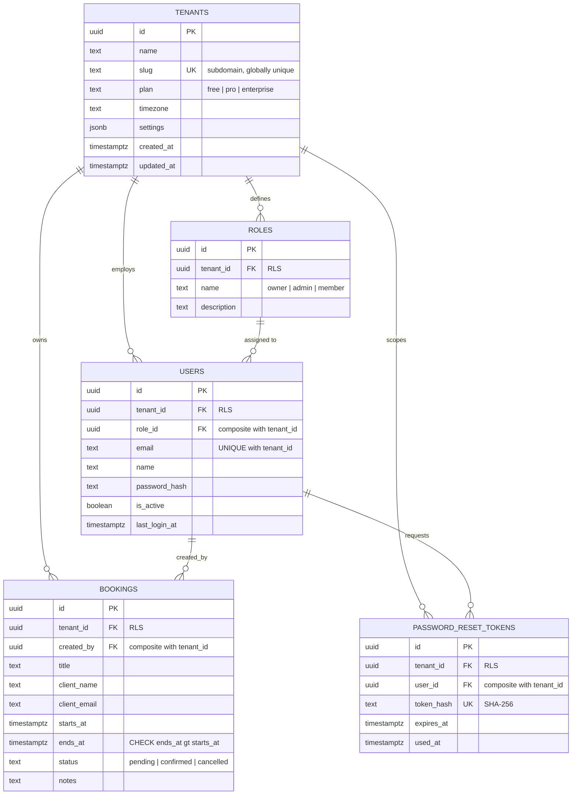

# Slotwise — Multi-Tenant SaaS Booking Platform

A multi-tenant booking platform where every organization gets its own private calendar, enforced **by the database itself** with PostgreSQL Row-Level Security.

> **Status: Week 1 of the internship track — Project Architecture & Multi-Tenant Schema ✅**

| Layer | Technology |
|---|---|
| Frontend | React 18, Vite, Tailwind CSS 3, React Router, Zod |
| Backend | Node.js 20, Express 4, Zod, JWT (httpOnly cookie), bcrypt |
| Database | PostgreSQL 16 with Row-Level Security |
| Infrastructure | Docker Compose |

---

## Table of contents
1. [Week 1 deliverables](#week-1-deliverables)
2. [Quick start (Docker, one command)](#quick-start-docker-one-command)
3. [Running without Docker (installing PostgreSQL)](#running-without-docker)
4. [Architecture & tenant isolation](#architecture--tenant-isolation)
5. [ERD](#erd)
6. [Verifying isolation](#verifying-isolation)
7. [Authentication UI](#authentication-ui)
8. [API reference](#api-reference)
9. [Environment variables](#environment-variables)
10. [Seed data](#seed-data)
11. [Project structure](#project-structure)
12. [Design decisions](#design-decisions)
13. [Troubleshooting](#troubleshooting)
14. [Roadmap](#roadmap)

---

## Week 1 deliverables

| Requirement | Status | Where |
|---|---|---|
| Project initialised (React + Express) | ✅ | `client/`, `server/` |
| `.env` validation with Zod | ✅ | `server/src/config/env.js` |
| Docker Compose with PostgreSQL | ✅ | `docker-compose.yml` |
| Schema: Tenants, Users, Roles, Bookings | ✅ | `server/src/db/migrations/001_init.sql` |
| Migration + seed scripts, realistic orgs | ✅ | `migrate.js`, `seed.js` (3 organizations) |
| Tenant isolation with RLS | ✅ | `002_rls.sql`, `withTenant()` in `pool.js` |
| Responsive auth UI: Onboarding, Login, Register, Password Reset | ✅ | `client/src/pages/` |
| Client-side form validation | ✅ | `lib/validation.js`, `lib/useForm.js` |
| README with Mermaid ERD + setup steps | ✅ | this file |

Beyond the brief: a runnable **isolation test suite** (`npm run test:isolation`) that attacks the database as a tenant and proves it holds.

---

## Quick start (Docker, one command)

**Prerequisite:** [Docker Desktop](https://www.docker.com/products/docker-desktop/) (Windows/macOS) or Docker Engine + Compose plugin (Linux).

```bash
git clone <your-repo-url> slotwise
cd slotwise
cp .env.example .env        # Windows PowerShell: Copy-Item .env.example .env
docker compose up --build
```

On first start Compose will: start PostgreSQL → wait until healthy → create the restricted `app_user` role → run migrations → seed three organizations → start the API and the React dev server.

| Service | URL |
|---|---|
| Web app | http://localhost:5173 |
| API health | http://localhost:4000/api/health |
| PostgreSQL | `localhost:5432` |

Sign in with a seeded account (see [Seed data](#seed-data)), e.g. org `brightside-dental`, email `owner@brightside.test`, password `Password123!`.

Useful commands:

```bash
docker compose exec server npm run test:isolation   # prove tenant isolation
docker compose exec server npm run seed:reset       # wipe and re-seed
docker compose down -v                              # stop and DELETE the database volume
```

---

## Running without Docker

### 1. Install PostgreSQL 16

- **Windows:** download the installer from https://www.postgresql.org/download/windows/ . Keep the default port `5432`, set a password for the `postgres` user (remember it), and leave "pgAdmin" and "Command Line Tools" ticked.
- **macOS:** `brew install postgresql@16 && brew services start postgresql@16`
- **Ubuntu/Debian:** `sudo apt update && sudo apt install postgresql && sudo service postgresql start`

### 2. Create the database

```bash
psql -U postgres -c "CREATE DATABASE slotwise;"
```

### 3. Configure, install, migrate, seed, run

```bash
cp .env.example .env     # make DATABASE_ADMIN_URL's password match the one you chose for postgres

cd server
npm install
npm run setup            # migrate + seed
npm run dev              # API on :4000

# in a second terminal
cd client
npm install
npm run dev              # web app on :5173
```

---

## Architecture & tenant isolation

Slotwise uses the **shared database, shared schema** multi-tenancy model: all organizations live in the same tables, and every tenant-owned row carries a `tenant_id`. Isolation is enforced in three independent layers so that one mistake never exposes data:

```mermaid
flowchart LR
    B[Browser<br/>React app] -- "/api/* + httpOnly cookie" --> A[Express API]
    A -- "1. verify JWT -> tenantId" --> M[withTenant&#40;tenantId&#41;]
    M -- "2. BEGIN;<br/>set_config&#40;'app.current_tenant', id, true&#41;" --> P[(PostgreSQL)]
    P -- "3. RLS policy filters every row:<br/>tenant_id = app_current_tenant&#40;&#41;" --> M
    subgraph DB roles
      O[postgres owner<br/>migrations and seed only]
      U[app_user<br/>NOSUPERUSER NOBYPASSRLS<br/>API runtime]
    end
    P --- O
    P --- U
```



**Layer 1: Identity.** The JWT (httpOnly, `SameSite=Lax` cookie) carries the user's `tenantId`. The tenant is *never* taken from request bodies after login.

**Layer 2: Transaction-scoped context.** `withTenant()` opens a transaction and runs `set_config('app.current_tenant', …, true)`. The `true` makes it transaction-local, so the value cannot leak to the next request that reuses the pooled connection.

**Layer 3: Row-Level Security.** Each tenant table has a policy `tenant_id = app_current_tenant()` for reads *and* writes (`USING` + `WITH CHECK`). With no tenant context the function returns `NULL`, which matches no rows: the database fails **closed**.

Additional boundaries:

| Boundary | Mechanism |
|---|---|
| API cannot bypass RLS | Runtime connects as `app_user` (`NOSUPERUSER NOBYPASSRLS`); migrations use a different owner connection |
| Pre-login tenant lookup | `resolve_tenant(slug)` is a narrow `SECURITY DEFINER` function returning only `id, name, slug`, so no policy has to be loosened |
| Cross-tenant references | Composite foreign keys, e.g. `bookings(tenant_id, created_by) → users(tenant_id, id)`, make it impossible for a booking to point at another tenant's user |
| Email uniqueness | `UNIQUE (tenant_id, email)`: the same person can have accounts in two organizations |
| Roles | Per-tenant `roles` table (`owner`, `admin`, `member`) |
| Reset tokens | Stored as SHA-256 hashes, single-use, expire after 1 hour, and are tenant-scoped by RLS |

---

## ERD



**Isolation boundary:** every table except `tenants` is scoped by `tenant_id`; `tenants` is scoped by its own `id`. All five tables have RLS enabled.

---

## Verifying isolation

```bash
npm run test:isolation      # from server/ (or: docker compose exec server npm run test:isolation)
```

The script connects as the runtime `app_user` and checks:

1. The role is not a superuser and has no `BYPASSRLS`
2. With no tenant context, **every** table returns zero rows
3. Tenant A sees only its own bookings, users and roles
4. `WHERE tenant_id = <B>` from A's context returns nothing
5. A cannot `INSERT` a row for B (policy violation `42501`)
6. A cannot `UPDATE`/`DELETE` B's rows (0 rows affected)
7. Composite FK blocks a booking owned by A but created by B's user (`23503`)
8. Tenant context does not leak between pooled connections

Expected: `All 8 isolation checks passed ✅`

---

## Authentication UI

Built with Tailwind CSS, responsive from phone to desktop (the decorative panel collapses below `lg`). Every form validates **on the client with Zod** (on blur and on submit) and again **on the server**; server errors are mapped back onto the right field.

| Route | Screen | Highlights |
|---|---|---|
| `/onboarding` | Organization onboarding | 2 steps; address auto-suggested from the name; **live, debounced availability check** for the subdomain; creates tenant + roles + owner in one transaction |
| `/login` | Sign in | Org address, email, password (show/hide); one generic error for all failures to prevent enumeration |
| `/register` | Join your team | Creates a `member` inside an existing organization |
| `/forgot-password` | Request reset | Always shows the same success message |
| `/reset-password?org=…&token=…` | New password | Handles missing/expired/used tokens |
| `/app` | Signed-in placeholder | Proves the session; real dashboard arrives in Week 2 |

Subdomain behaviour: opening `http://brightside-dental.localhost:5173` pre-fills the organization address. In production this becomes real subdomain routing (`brightside-dental.slotwise.app`).

Accessibility: labelled inputs, `aria-invalid`/`aria-describedby`, error `role="alert"`, visible focus rings, reduced-motion respected.

---

## API reference

Base URL `/api`. Errors: `{ "error": string, "fields"?: { [field]: string } }`.

| Method | Path | Auth | Description |
|---|---|---|---|
| GET | `/health` | – | API + database liveness |
| GET | `/tenants/slug-available/:slug` | – | `{ available }` for onboarding |
| GET | `/tenants/resolve/:slug` | – | Public name/slug of an org |
| POST | `/auth/onboard` | – | Create organization + owner, sign in (201) |
| POST | `/auth/register` | – | Join an org as `member` (201) |
| POST | `/auth/login` | – | Sign in, sets session cookie |
| POST | `/auth/logout` | – | Clears cookie (204) |
| GET | `/auth/me` | cookie | Current user + tenant |
| POST | `/auth/forgot-password` | – | Creates reset token (link logged in dev) |
| POST | `/auth/reset-password` | – | Consumes token, sets new password |

Auth endpoints are rate-limited (60 requests / 15 min / IP).

---

## Environment variables

Validated at startup with Zod (`server/src/config/env.js`); the API refuses to boot with a clear message if anything is missing or malformed.

| Variable | Purpose |
|---|---|
| `POSTGRES_USER` / `POSTGRES_PASSWORD` / `POSTGRES_DB` / `POSTGRES_PORT` | The PostgreSQL container |
| `APP_DB_PASSWORD` | Password for the restricted runtime role `app_user` (min 8 chars) |
| `DATABASE_ADMIN_URL` | Owner connection: migrations, seed, isolation test only |
| `DATABASE_URL` | Runtime connection as `app_user` (RLS applies) |
| `JWT_SECRET` | Signing secret, **min 32 chars** |
| `JWT_EXPIRES_IN` | Session lifetime (default `7d`) |
| `CLIENT_ORIGIN` | Allowed CORS origin and reset-link base |
| `PORT`, `NODE_ENV` | API port and mode |

Docker Compose overrides the two connection URLs so the host is `db`.

---

## Seed data

Every seeded account uses the password **`Password123!`**.

| Organization (`slug`) | Plan | Timezone | Accounts |
|---|---|---|---|
| Brightside Dental (`brightside-dental`) | pro | America/New_York | `owner@brightside.test`, `admin@brightside.test`, `frontdesk@brightside.test` |
| Northwind Physio (`northwind-physio`) | enterprise | Europe/London | `owner@northwind.test`, `admin@northwind.test`, `therapist@northwind.test` |
| Atlas Coworking (`atlas-coworking`) | free | Asia/Karachi | `owner@atlas.test`, `admin@atlas.test`, `community@atlas.test` |

Each organization has 5 bookings (confirmed / pending / cancelled) dated relative to today. The seed is idempotent; `npm run seed:reset` wipes and re-seeds.

---

## Project structure

```
slotwise/
├── docker-compose.yml          # db + server + client
├── .env.example
├── server/
│   ├── Dockerfile
│   ├── scripts/verify-isolation.js
│   └── src/
│       ├── config/env.js       # Zod env validation
│       ├── db/
│       │   ├── migrations/     # 001_init.sql, 002_rls.sql
│       │   ├── pool.js         # runtime pool + withTenant() + resolveTenant()
│       │   ├── admin.js        # owner pool (migrate/seed only)
│       │   ├── migrate.js      # tiny migration runner (+ creates app_user)
│       │   └── seed.js
│       ├── lib/                # schemas, HttpError, asyncRouter
│       ├── middleware/         # auth, validate, errorHandler
│       ├── routes/             # auth.js, tenants.js
│       ├── app.js
│       └── index.js
└── client/
    ├── Dockerfile
    └── src/
        ├── components/         # AuthLayout, Field, Alert, OrgField
        ├── lib/                # api, validation, useForm, AuthContext
        └── pages/              # Onboarding, Login, Register, ForgotPassword, ResetPassword, AppHome
```

---

## Design decisions

- **RLS over "remember to add WHERE tenant_id".** Application-level filters fail silently the day someone forgets one. RLS moves the guarantee into the database.
- **Two database roles.** Superusers and table owners bypass RLS, so the API runs as a limited `app_user`; only migrations use the owner.
- **Transaction-local tenant setting** (`set_config(…, true)`) is safe with connection pooling.
- **`SECURITY DEFINER` resolver** instead of a permissive policy: login needs to find a tenant before it has a tenant context, and this exposes the minimum possible surface.
- **Composite foreign keys** protect integrity across tenants, beyond what RLS alone provides.
- **httpOnly cookie sessions** rather than `localStorage` tokens, to keep tokens out of reach of XSS.
- **Plain SQL migrations** with a ~40-line runner: transparent for learning; an ORM migration tool can replace it later without changing the schema.
- **Zod on both sides** gives instant UX feedback while the server stays the source of truth.

---

## Troubleshooting

| Symptom | Fix |
|---|---|
| `Invalid environment variables` on boot | Copy `.env.example` to `.env` and fill the listed variables |
| `port 5432 is already allocated` | A local PostgreSQL is running. Stop it or set `POSTGRES_PORT=5433` in `.env` |
| `password authentication failed for user "postgres"` (no Docker) | Make `DATABASE_ADMIN_URL` use the password you set during installation |
| Changed `.env` but DB still uses old password | The volume keeps the first password: `docker compose down -v` then `up --build` |
| Hot reload not working on Windows | Already handled with polling; restart with `docker compose restart client` |
| `/api` calls fail in the browser | Confirm `http://localhost:4000/api/health` responds |

---

## Roadmap

- [x] **Week 1:** Architecture, multi-tenant schema, RLS, auth UI
- [ ] **Week 2:** Admin dashboard (sidebar), booking calendar with create/edit/delete and validation
- [ ] **Week 3:** Idempotency keys for double-booking protection, Stripe subscriptions and webhooks
- [ ] **Week 4:** Real-time collaborative notes (Yjs CRDT + presence), Redis tenant-config cache, zero-downtime migrations, deployment
